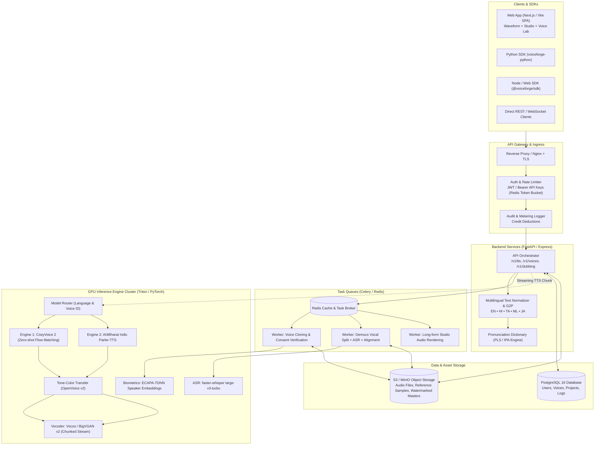
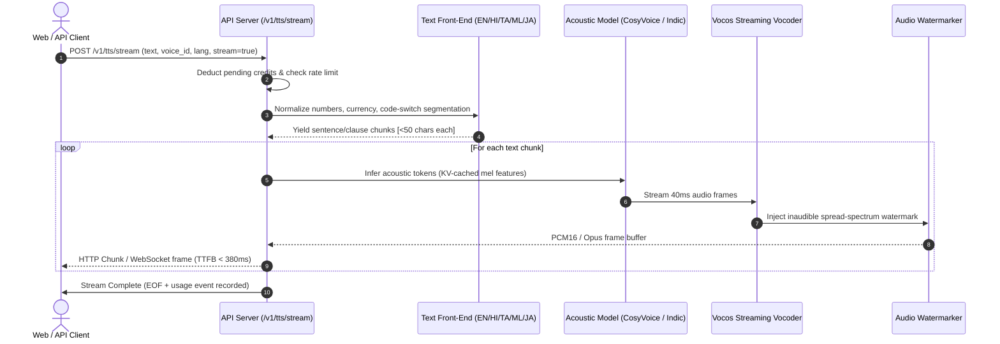
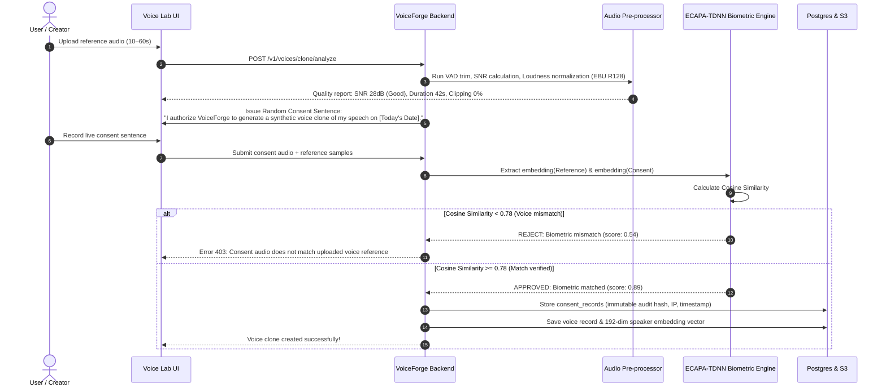
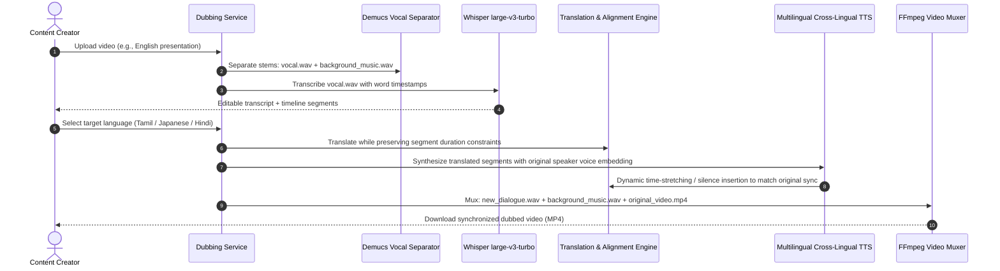

# VoiceForge Architecture Specification

## 1. High-Level System Architecture

---

## 2. Low-Latency Streaming TTS Pipeline

---

## 3. Instant Voice Cloning & Biometric Consent Verification

---

## 4. AI Dubbing & Video Vocal Muxing Flow

